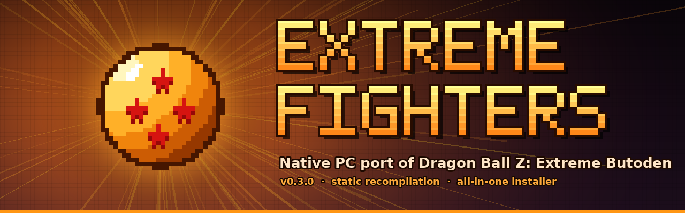

<p align="center">
  
</p>

<h1 align="center">Extreme Fighters</h1>

<p align="center">🇬🇧 <a href="README.md">Read in English</a></p>

<p align="center"><b>Versión 0.5.0</b> · en desarrollo · <a href="CHANGELOG.md">registro de cambios</a></p>

<p align="center">
  <b>Port nativo para PC (Windows x64) de <i>Dragon Ball Z: Extreme Butoden</i> de 3DS</b><br>
  Recompilación estática a código nativo + instalador todo en uno: eliges tu <code>.3ds</code> y a jugar.
</p>

<p align="center">
  <a href="../../releases/latest"><b>⬇️ Descargar la última versión</b></a>
</p>

---

> ⚠️ **Este proyecto NO incluye el juego.** Necesitas tu propia copia **descifrada** (`.3ds`) sacada de tu cartucho original. No pidas ROMs: no se comparten aquí. Tampoco compartas el código nativo generado (`nativo\*.dll`), porque sale de tu copia del juego.

## ¿Qué es esto?

**Extreme Fighters** es un port nativo para PC de *Dragon Ball Z: Extreme Butoden* (3DS). El código del juego de 3DS se **traduce a C y se compila a código nativo x64** en tu PC con [3dsrecomp](https://github.com/fearkov/3dsrecomp). Así el juego no se emula instrucción a instrucción: casi todo el código corre como un programa nativo. El resto de la consola (gráficos, sonido, sistema…) lo pone [Zakuro](https://github.com/fearkov/zakuro), en una **edición DBZ** modificada para este juego.

Todo se hace con un instalador gráfico: solo le das el `.3ds`.

## ✨ Novedades de esta versión

### 🎮 Juego y controles
- **Código nativo recompilado**: el juego corre como código x64 nativo en vez de interpretado, así va con más fluidez y gasta menos CPU.
- **Cambiar de personaje / llamar al striker con los gatillos**: cada pulsación **toca** la carta del personaje en la pantalla táctil, como el dedo en la 3DS. Dos esquemas en *Opciones → Controles de combate*:
  - **Gatillos** (por defecto): **L2** = 2.ª carta · **R2** = 3.ª carta · **L2 + R2 a la vez** = 4.ª carta.
  - **L2 + botón** (equipos grandes): **R2** = 2.ª carta; **mantén L2** y pulsa el botón de **la izquierda / arriba / derecha / abajo** = 2.ª / 3.ª / 4.ª / 5.ª carta.
  - Con más cartas cambian de sitio: pulsa **Ajustar** junto a cada carta y **haz clic en ella** en la pantalla inferior.
  - Los controles se aprenden de tu propio mando (funciona con 8BitDo y otros), con indicador en directo.
- **Desbloquear todo**: *Opciones → Partidas guardadas → Importar partida guardada…* carga una partida al 100 % (copia de Checkpoint/JKSM o partida de Citra/Azahar). Antes se hace copia de tu partida actual.
- **Compatible con mandos** de Xbox, PlayStation y genéricos: el stick izquierdo es el Circle Pad y el botón Home abre el menú.
- **Estados de guardado** (save states) en 9 ranuras, además de las partidas normales del juego.

### 🖥️ Pantalla adaptada al PC
- **Pantalla superior completa**: la principal ocupa todo el alto del monitor, y la inferior va como **ventana pequeña encima, en una esquina** (tamaño y lado ajustables). **F10** la muestra u oculta.
- **Arranca en pantalla completa** directamente (F11 para alternar con ventana).
- **Calidad gráfica por niveles**: Rendimiento (2×), Equilibrada (3×), Alta (4×) y Ultra (6×). El instalador **elige una automáticamente según tu tarjeta gráfica**.
- Filtros de imagen y soporte para packs de texturas.

### 🌍 Idiomas
- **Instalador en 7 idiomas**: español, inglés, francés, alemán, italiano, japonés y chino.
- **El juego arranca en el idioma elegido en el instalador** (siempre que tu versión del juego lo incluya).
- **Menú del emulador traducido** a esos 7 idiomas. Se cambia en *Opciones → Interfaz → Idioma del menú*.

### 🟠 Zakuro edición DBZ (menú personalizado)
- Menú de pausa (**Esc** o **Home**) y opciones rediseñados con el estilo del juego: fondo oscuro, bordes y resaltado naranja, letra más grande (Bahnschrift).
- Menú simplificado: Continuar, Reiniciar, Pantalla completa, Guardar/Cargar estado, **Online**, Opciones, Trucos y Salir.
- Fuera lo que no pinta nada en un port: biblioteca de juegos, cámara, informes de errores…
- **Online**: salas para jugar por internet usando el combate inalámbrico local del propio juego (sin rollback).
- **Crear sala online**: el juego **abre tu router solo (UPnP)** y te da un **código de sala** tipo `EF-7K2M4-9QX41`. Tus amigos lo escriben y entran: conexión directa, con el menor retraso posible.
- Si tu conexión no puede recibir jugadores (**CG-NAT**), el juego te avisa y te propone unirte a la sala de otro o a un servidor público.
- **Lista de salas públicas** con el **ping** de cada sala, las más cercanas primero. Solo el servidor de salas necesita abrir puertos.

### 🔄 Actualizaciones automáticas
- El **instalador** consulta GitHub al abrirse y muestra el botón **ACTUALIZAR A vX.X.X** cuando hay versión nueva.
- **En el juego** (menú de pausa): **Buscar actualizaciones** y **Actualizar a vX.X.X**. También lo comprueba solo al arrancar y avisa.
- Al actualizar se descarga la versión nueva, se conservan partidas, configuración y el juego recompilado (sin recompilar) y se vuelve a abrir el juego.

### 📦 Instalador todo en uno
- **Solo pide el `.3ds`**: el recompilador viene ya compilado. No hace falta Rust, Visual Studio ni instalar compiladores a mano.
- Comprueba que la ROM es válida y está **descifrada** antes de empezar.
- Descarga solo el compilador de C portable (Zig) y verifica que el archivo es correcto (SHA-256).
- Barra de progreso, comprobaciones de sistema y espacio libre, y registros (logs) si algo falla.
- Crea accesos directos en el **Escritorio** y el **menú Inicio** con el icono de la bola de 4 estrellas.

### 💾 100 % portátil
- **Eliges la carpeta de instalación**: otro disco, un USB…
- **Todo** queda dentro: juego, motor, código nativo, partidas, configuración (AppData), caché de gráficos y temporales. Nada se escribe en tu perfil de Windows.
- Puedes **mover o copiar la carpeta a otro PC** y sigue funcionando con tus partidas y tu configuración.

## 📋 Requisitos
- Windows 10 (1803 o posterior) u 11, **64 bits**.
- Tu `.3ds` **descifrado** de *Dragon Ball Z: Extreme Butoden*.
- Espacio libre: tamaño del juego + unos 2,5 GB durante la instalación.
- Internet durante la instalación (para descargar el compilador, ~100 MB).
- GPU con Vulkan (recomendado) u OpenGL.

## 🚀 Instalación
1. Descarga `ExtremeFighters_Instalador.zip` desde [Releases](../../releases/latest) y **extrae todo** en una carpeta.
2. Abre **`Instalar.exe`**. Si aparece SmartScreen: *Más información → Ejecutar de todas formas* (el ejecutable no está firmado).
3. (Opcional) Elige el **idioma** arriba a la derecha.
4. Elige tu **`.3ds`** y la **carpeta de instalación**.
5. Pulsa **INSTALAR / RECOMPILAR** y espera 10–20 minutos (solo la primera vez).
6. Pulsa **JUGAR**, o usa el acceso directo del Escritorio o `Jugar.exe` dentro de la carpeta.

### Estructura de la carpeta instalada
```
juego\       tu copia del .3ds
zakuro\      motor (Zakuro edición DBZ)
nativo\      código nativo recompilado (<TitleID>.dll)
partidas\    partidas guardadas y mods
appdata\     configuración, caché de gráficos y temporales
tools\       compilador Zig (se puede borrar tras instalar)
logs\        registros de la instalación
Jugar.exe    abre el juego
```

## 🌐 Jugar online
**Con amigos (recomendado):** *Esc → Online → Crear sala online* y comparte el **código de sala**. Tus amigos van a *Online → Código de sala o dirección*, lo escriben y pulsan **Unirse**. No hace falta descargar nada más.

**Servidor de salas (opcional):** para comunidades que quieran salas abiertas las 24 horas, en el Release también va **`ExtremeFighters_Servidor.zip`**: un programa pequeño (Windows y Linux) que mantiene varias salas abiertas y publica su lista.
1. Arráncalo en un PC que esté encendido o en un servidor (VPS): `Iniciar_servidor.bat` en Windows, `./ef-servidor-linux` en Linux.
2. Abre los puertos TCP **24872-24878** en el router o el cortafuegos de ese equipo.
3. Compruébalo en el navegador: `http://TU-IP:24872/`.
4. En el juego: *Online → Salas públicas → Servidor*: escribe la IP o dominio → **Actualizar** → **Unirse**.

Opciones: `--salas 6`, `--jugadores 2`, `--puerto 24873`, `--puerto-lista 24872`, `--contrasena X`. Más detalles en `LEEME_SERVIDOR.txt`.

## 🕹️ Controles por defecto

| 3DS | Mando (Xbox / PlayStation) | Teclado |
|---|---|---|
| A / B / X / Y | B / A / Y / X  ·  ○ / ✕ / △ / □ | X / Z / S / A |
| L / R | LB / RB  ·  L1 / R1 | Q / W |
| **Carta 2.º / 3.º personaje** | **LT / RT  ·  L2 / R2** | (ratón en la pantalla inferior) |
| Circle Pad | Stick izquierdo | I / J / K / L |
| Cruceta | Cruceta | Flechas |
| Start / Select | Start / Back | Enter / Retroceso |
| Menú de pausa | Home | Esc |

**Atajos:** F1 pausa · F5 guardar estado · F8 cargar estado · F9 cambiar disposición de pantallas · F10 mostrar/ocultar la pantalla inferior pequeña · F11 pantalla completa · Tab (o clic del stick derecho) avance rápido.

Todo se reasigna en *Opciones → Mando / Teclado / Controles de combate*.

## ❓ Problemas frecuentes
- **"Esta ROM está cifrada"**: necesitas un `.3ds` descifrado de tu cartucho.
- **SmartScreen bloquea `Instalar.exe`**: *Más información → Ejecutar de todas formas*.
- **Algo falla al instalar**: mira la carpeta `logs\` dentro de la carpeta de instalación (sobre todo `recompilar.err.log`) y abre un *issue* adjuntándolo.
- **L2/R2 no tocan bien la carta**: abre un *issue* con una captura de la pantalla inferior durante un combate.
- **Quiero jugar en ventana**: pulsa F11, o en `jugar.ini` cambia `pantalla_completa=1` por `pantalla_completa=0`.

## ⚠️ Limitaciones conocidas
- El **online no tiene rollback**: usa el sistema de red del propio juego (por salas), así que con mucha latencia se nota el retraso.
- Algunas descripciones largas del menú (las que salen al pasar el ratón) siguen en inglés.
- Es un proyecto de fans en desarrollo: puede haber fallos gráficos o de rendimiento heredados de la emulación.

## 🛠️ Compilar desde el código fuente
Todo se compila desde Linux para Windows con Rust y MinGW-w64:
```bash
rustup target add x86_64-pc-windows-gnu
sudo apt install gcc-mingw-w64-x86-64 git zip
./herramientas/compilar.sh
```
- `instalador/` — instalador (PowerShell + WinForms), imágenes y lanzadores en C (`Instalar.exe`, `Jugar.exe`).
- `zakuro-dbz/zakuro-dbz.patch` — los cambios de la edición DBZ sobre Zakuro **v0.2.32** (menú traducido y con estilo propio, gatillos táctiles, Online).
- `herramientas/` — script de compilación y generador del icono pixel art.

## 🙏 Créditos
- **[fearkov](https://github.com/fearkov)**, autor de [Zakuro](https://github.com/fearkov/zakuro) y [3dsrecomp](https://github.com/fearkov/3dsrecomp), que hacen posible todo esto. Si te gusta el proyecto, apoya el suyo.
- [Zig](https://ziglang.org), el compilador de C portable que usa la instalación.
- Instalador, Zakuro edición DBZ y documentación desarrollados con ayuda de [Claude](https://claude.ai) (Anthropic).

## ⚖️ Aviso legal
Proyecto de fans **sin ánimo de lucro** y **sin relación** con Bandai Namco, Bird Studio/Shueisha, Toei Animation ni Nintendo. *Dragon Ball*, *Dragon Ball Z: Extreme Butoden*, sus personajes, logotipos e ilustraciones pertenecen a sus respectivos dueños. Este repositorio no contiene código ni archivos del juego. No se apoya la piratería: usa solo copias de juegos que poseas.

El código propio de este proyecto está bajo licencia [MIT](LICENSE). Zakuro y 3dsrecomp son MIT de fearkov.

---

<details>
<summary><b>English summary</b></summary>

**Extreme Fighters** is a native PC (Windows x64) port of *Dragon Ball Z: Extreme Butoden* (3DS) through static recompilation with 3dsrecomp, running on a customised **Zakuro DBZ edition**. The all-in-one installer only asks for **your own decrypted `.3ds`**.

Highlights: native recompiled code · **L2/R2 touch the 2nd/3rd character cards** (switch / striker) · big top screen + small bottom screen, fullscreen by default · installer and emulator menus in 7 languages, game starts in the chosen language · restyled, simplified pause menu with **Online** rooms (no rollback) · fully **portable** install in any folder (AppData, graphics cache and saves included).

No game files are included. Not affiliated with Bandai Namco, Bird Studio/Shueisha, Toei Animation or Nintendo.
</details>
