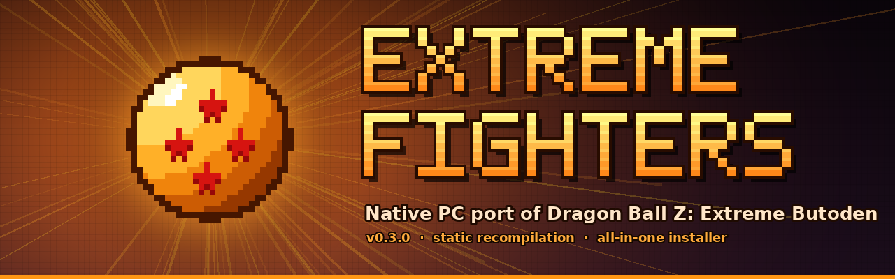

<p align="center">
  
</p>

<h1 align="center">Extreme Fighters</h1>

<p align="center">🇪🇸 <a href="README.es.md">Leer en español</a></p>

<p align="center"><b>Version 0.3.0</b> · in development · <a href="CHANGELOG.md">changelog</a></p>

<p align="center">
  <b>Native PC (Windows x64) port of <i>Dragon Ball Z: Extreme Butoden</i> (Nintendo 3DS)</b><br>
  Static recompilation to native code + an all-in-one installer: pick your <code>.3ds</code> and play.
</p>

<p align="center">
  <a href="../../releases/latest"><b>⬇️ Download the latest release</b></a>
</p>

---

> ⚠️ **This project does NOT include the game.** You need your own **decrypted** copy (`.3ds`) dumped from a cartridge you own. Don't ask for ROMs, they are not shared here. Don't share the generated native code either (`nativo\*.dll`): it is built from your copy of the game.

## What is this?

**Extreme Fighters** turns the 3DS game into a native PC program. During installation, the game's ARM code is **translated to C and compiled into native x64 code** on your PC by [3dsrecomp](https://github.com/fearkov/3dsrecomp). The game no longer runs instruction by instruction in an emulator: nearly all of its code runs as native code (in the games 3dsrecomp has been tested with, over 99 %). The rest of the console (graphics, sound, system services…) is provided by [Zakuro](https://github.com/fearkov/zakuro), in a **DBZ edition** tailored to this game.

A graphical installer does everything for you: you only give it the `.3ds`.

### How the recompilation works
1. **Analysis:** 3dsrecomp reads the game's executable and its modules (CRO) and finds every function, following calls, exports, relocations and pointers.
2. **Translation:** each function's ARM, Thumb and VFP code is turned into C. The few uncommon instructions it can't translate still run through Zakuro's interpreter.
3. **Compilation:** the generated C is compiled with Zig's portable C compiler into a native library (`<TitleID>.dll`).
4. **Execution:** Zakuro loads that library and runs the game on native code, with its interpreter as a safety net for anything left.

## ✨ Features

### 🎮 Gameplay & controls
- **Natively recompiled code**: the game runs as native x64 code instead of being interpreted, so it runs smoother and uses less CPU.
- **Switch character / call your striker with the triggers**:
  - **L2** = 2nd character's card · **R2** = 3rd character's card.
  - Holding the trigger touches that card on the touch screen, like your finger on the 3DS. No mouse needed.
  - Rebind or disable them in *Options → Combat controls*.
- **Controller support** for Xbox, PlayStation and generic pads: the left stick is the Circle Pad and the Home button opens the menu.
- **Save states** in 9 slots, on top of the game's own saves.

### 🖥️ PC-friendly display
- **Full top screen**: the main screen fills the whole height of your monitor, with the bottom screen as a **small window over a corner** (size and side adjustable). **F10** shows or hides it.
- **Starts in fullscreen** (F11 toggles windowed mode).
- **Graphics quality presets**: Performance (2×), Balanced (3×), High (4×) and Ultra (6×). The installer **picks one automatically for your graphics card**.
- Image filters and texture pack support.

### 🌍 Languages
- **Installer in 7 languages**: Spanish, English, French, German, Italian, Japanese and Chinese.
- **The game starts in the language chosen in the installer** (if your copy of the game includes it).
- **Emulator menu translated** into those 7 languages. Change it in *Options → Interface → Menu language*.

### 🟠 Zakuro DBZ edition (custom menu)
- Pause menu (**Esc** or **Home**) and options restyled to match the game: dark background, orange borders and highlights, larger text (Bahnschrift).
- Streamlined menu: Resume, Reset, Fullscreen, Save/Load state, **Online**, Options, Cheats and Quit.
- Removed what makes no sense in a port: game library, camera, bug-report tools…
- **Online**: rooms to play over the internet using the game's own local wireless battle (no rollback).
- **Public room list**: type the address of an Extreme Fighters room server and join a room with one click. Only the server needs open ports, not the players.

### 📦 All-in-one installer
- **Only asks for the `.3ds`**: the recompiler comes prebuilt. No Rust, Visual Studio or manual compiler setup.
- Checks that the ROM is valid and **decrypted** before starting.
- Downloads only the portable C compiler (Zig) and checks that the file is correct (SHA-256).
- Progress bar, system and free-space checks, and logs if anything fails.
- Creates **Desktop** and **Start menu** shortcuts with the 4-star Dragon Ball icon.

### 💾 100 % portable
- **You choose the install folder**: another drive, a USB stick…
- **Everything** stays inside it: game, engine, native code, saves, settings (AppData), graphics cache and temp files. Nothing is written to your Windows profile.
- **Move or copy the folder to another PC** and it keeps working, with your saves and settings.

## 📋 Requirements
- Windows 10 (1803 or later) or 11, **64-bit**.
- Your **decrypted** `.3ds` of *Dragon Ball Z: Extreme Butoden*.
- Free space: game size + about 2.5 GB during installation.
- Internet connection during installation (compiler download, ~100 MB).
- GPU with Vulkan (recommended) or OpenGL.

## 🚀 Installation
1. Download `ExtremeFighters_Instalador.zip` from [Releases](../../releases/latest) and **extract everything** into a folder.
2. Run **`Instalar.exe`**. If SmartScreen appears: *More info → Run anyway* (the executable isn't signed).
3. (Optional) Pick the **language** in the top-right corner.
4. Choose your **`.3ds`** and the **install folder**.
5. Click **INSTALL / RECOMPILE** and wait 10–20 minutes (first time only).
6. Click **PLAY**, or use the Desktop shortcut or `Jugar.exe` inside the install folder.

### Installed folder layout
```
juego\       your copy of the .3ds
zakuro\      engine (Zakuro DBZ edition)
nativo\      recompiled native code (<TitleID>.dll)
partidas\    saves and mods
appdata\     settings, graphics cache and temp files
tools\       Zig compiler (can be deleted after installing)
logs\        installation logs
Jugar.exe    starts the game
```

## 🌐 Online room server
The release also includes **`ExtremeFighters_Servidor.zip`**: a small program (Windows and Linux) that keeps several online rooms open and publishes their list.
1. Run it on a PC that stays on or on a server (VPS): `Iniciar_servidor.bat` on Windows, `./ef-servidor-linux` on Linux.
2. Open TCP ports **24872-24878** on that machine's router or firewall.
3. Check it in a browser: `http://YOUR-IP:24872/`.
4. In the game: *Online → Public rooms → Server*: type the IP or domain → **Refresh** → **Join**.

Options: `--salas 6`, `--jugadores 2`, `--puerto 24873`, `--puerto-lista 24872`, `--contrasena X`. See `LEEME_SERVIDOR.txt`.

## 🕹️ Default controls

| 3DS | Controller (Xbox / PlayStation) | Keyboard |
|---|---|---|
| A / B / X / Y | B / A / Y / X  ·  ○ / ✕ / △ / □ | X / Z / S / A |
| L / R | LB / RB  ·  L1 / R1 | Q / W |
| **2nd / 3rd character card** | **LT / RT  ·  L2 / R2** | (mouse on the bottom screen) |
| Circle Pad | Left stick | I / J / K / L |
| D-pad | D-pad | Arrow keys |
| Start / Select | Start / Back | Enter / Backspace |
| Pause menu | Home | Esc |

**Hotkeys:** F1 pause · F5 save state · F8 load state · F9 change screen layout · F10 show/hide the small bottom screen · F11 fullscreen · Tab (or right stick click) fast forward.

Everything can be rebound in *Options → Controller / Keyboard / Combat controls*.

## ❓ Troubleshooting
- **"This ROM is encrypted"**: you need a decrypted `.3ds` dumped from your cartridge.
- **SmartScreen blocks `Instalar.exe`**: *More info → Run anyway*.
- **The installation fails**: check the `logs\` folder inside the install folder (especially `recompilar.err.log`) and open an *issue* with it attached.
- **L2/R2 miss the character card**: open an *issue* with a screenshot of the bottom screen during a fight.
- **I want windowed mode**: press F11, or change `pantalla_completa=1` to `pantalla_completa=0` in `jugar.ini`.

## ⚠️ Known limitations
- **Online has no rollback**: it uses the game's own netcode through rooms, so high latency causes noticeable lag.
- Some long tooltips in the menu are still in English only.
- This is a fan project in development: graphical or performance glitches inherited from emulation may appear.

## 🛠️ Building from source
Everything is cross-compiled from Linux to Windows with Rust and MinGW-w64:
```bash
rustup target add x86_64-pc-windows-gnu
sudo apt install gcc-mingw-w64-x86-64 git zip
./herramientas/compilar.sh
```
The script builds 3dsrecomp (commit `df82e6e3`, the one Zakuro v0.2.32 uses), applies the DBZ patch to Zakuro **v0.2.32** and builds it, compiles the launchers and packs `ExtremeFighters_Instalador.zip`.

| Folder | Contents |
|---|---|
| `instalador/` | Installer (PowerShell + WinForms), images and C launchers (`Instalar.exe`, `Jugar.exe`) |
| `zakuro-dbz/zakuro-dbz.patch` | DBZ edition changes on top of Zakuro v0.2.32: translated, restyled menu, touch triggers, full top screen layout, quality presets, public rooms and the `ef-servidor` room server |
| `herramientas/` | Build script and pixel-art icon generator |

## 🙏 Credits
- **[fearkov](https://github.com/fearkov)**, author of [Zakuro](https://github.com/fearkov/zakuro) and [3dsrecomp](https://github.com/fearkov/3dsrecomp), which make all of this possible. If you like this project, support theirs.
- [Zig](https://ziglang.org), the portable C compiler used during installation.
- Installer, Zakuro DBZ edition and documentation developed with the help of [Claude](https://claude.ai) (Anthropic).

## ⚖️ Legal notice
Non-profit **fan project**, **not affiliated** with Bandai Namco, Bird Studio/Shueisha, Toei Animation or Nintendo. *Dragon Ball*, *Dragon Ball Z: Extreme Butoden*, their characters, logos and artwork belong to their respective owners. This repository contains no game code or files. Piracy is not supported: only use copies of games you own.

This project's own code is released under the [MIT](LICENSE) license. Zakuro and 3dsrecomp are MIT-licensed by fearkov.
